| | |
|---|---|
| **Course** | CSA06 – Design and Analysis of Algorithms |
| **Assessment** | CO2 – Debugging and Optimisation Task (50 marks) |
| **Student Reg. No. / Name** | ______________________ / ______________________ |
| **GitHub repository** | `https://github.com/<your-username>/CO2_Debugging_Optimisation` |
| **Python / platform** | Python 3.12, standard library only for the module; `matplotlib`, `Pygments`, `Pillow` only for graphs/screenshots |

All outputs, counts and timings in this report were produced by the code in `Source_Code/` and are stored in `Supporting_Files/` (logs, CSV/JSON). Timings are machine-dependent; operation counts are exact.

# Part (a) – Reproduce and identify the defects (10 marks)

## a.1 Expected vs actual output (original module, course test data)

The original module was run unchanged (`python original_sentinelops.py`, log: `Supporting_Files/log_1_original_run.txt`).

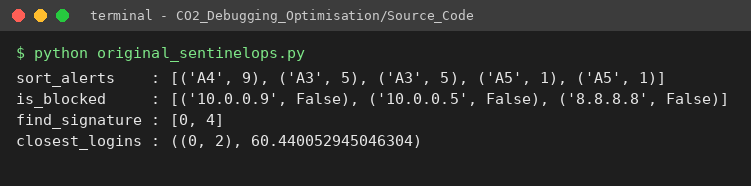{width=85%}

| Function | Input | Expected output | Actual output (original) | Symptom |
|---|---|---|---|---|
| `sort_alerts` | `A1:3, A2:9, A3:5, A4:9, A5:1` | `[A2:9, A4:9, A3:5, A1:3, A5:1]` | `[A4:9, A3:5, A3:5, A5:1, A5:1]` | A1, A2 **disappeared**; A3, A5 **duplicated**; order wrong |
| `is_blocked` | queries `10.0.0.9`, `10.0.0.5`, `8.8.8.8` | `True, True, False` | `False, False, False` | blocked IPs **got through** |
| `find_signature` | `"FAILFAIXFAIL"`, `"FAIL"` | `[0, 8]` | `[0, 4]` | signature at the end **missed**; `FAIX` at 4 reported as a **false hit** |
| `closest_logins` | 6 events (km) | `((0, 5), 1.4142 km)` | `((0, 2), 60.44 km)` | returns the **farthest** pair, not the closest |

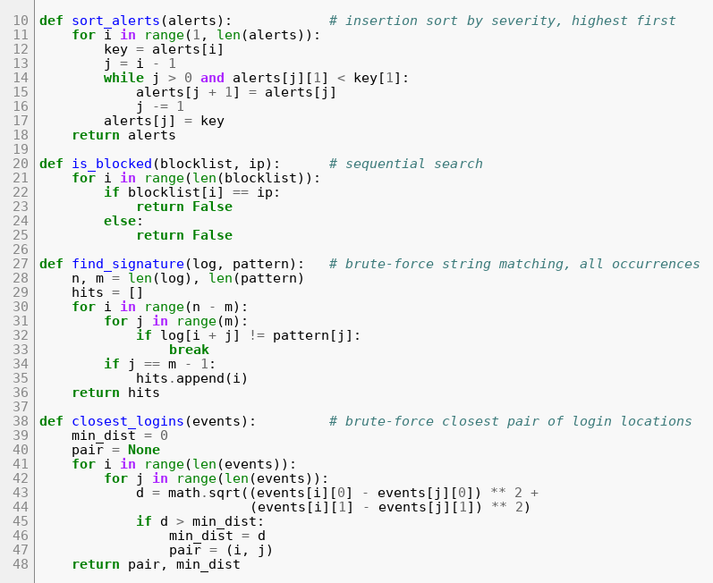{width=90%}

## a.2 The nine defects

Fault lines are quoted exactly as they appear in the original code.

| # | Function | Faulty line (original) | Nature of the error | Effect |
|---|---|---|---|---|
| **D1** | `sort_alerts` | `while j > 0 and alerts[j][1] < key[1]:` | Off-by-one loop bound: index 0 is never compared or shifted | `alerts[0]` is never moved; key overwrites it |
| **D2** | `sort_alerts` | `alerts[j] = key` | Wrong insertion index: after the shifts the free slot is `j + 1` | The key overwrites a live element → alerts lost / duplicated |
| **D3** | `is_blocked` | `if blocklist[i] == ip:` → `return False` | Inverted result on a match | A blocked IP is reported clean |
| **D4** | `is_blocked` | `else: return False` | Premature return inside the loop (only `blocklist[0]` is ever tested); there is also no terminal `return`, so an empty blocklist returns `None` | Search ends after one element |
| **D5** | `find_signature` | `for i in range(n - m):` | Off-by-one: the last window `i = n - m` is skipped | Signature at the end of the log missed; pattern equal to the log missed |
| **D6** | `find_signature` | `if j == m - 1:` | Wrong match test: `j` is also `m-1` when the **last character mismatches** (`break` at `j = m-1`) | False hits such as `FAIX` |
| **D7** | `closest_logins` | `min_dist = 0` | Wrong initial value for a minimum search (must be `+∞`) | No distance is ever smaller than the start value |
| **D8** | `closest_logins` | `if d > min_dist:` | Wrong comparison direction – this is a **maximum** search | Returns the farthest pair |
| **D9** | `closest_logins` | `for j in range(len(events)):` | Inner loop covers all `j`: self pairs `(i,i)` (d = 0) and each pair twice | `n²` instead of `n(n−1)/2` distance computations; self pair `d = 0` would win once D7/D8 are fixed |

*Counting note.* The missing terminal `return False` of `is_blocked` sits on the same lines as D4, so it is counted inside D4. One additional **latent boundary defect (H1)** was found by the boundary tests and is not one of the nine: with an empty pattern the original raises `UnboundLocalError` (`j` is never assigned) and, after D6 is fixed, a naïve `for…else` would report every index – the corrected code returns `[]`.

## a.3 Which defect explains which production symptom

| Production symptom | Defects |
|---|---|
| Alerts disappeared or duplicated | D1, D2 |
| Blocked IP addresses got through | D3, D4 |
| Signatures at the end of a log missed | D5 |
| False signatures reported | D6 |
| "Closest logins" hundreds of km apart | D7, D8 (and D9 for the self/duplicate pairs) |

# Part (b) – Root causes and systematic debugging (12 marks)

**Method.** The code was *not* rewritten. `Source_Code/debug_session.py` reads the original source text and applies each fix as one exact text substitution, cumulatively, re-running the probes of the affected function after every single fix (full log: `Supporting_Files/log_2_debug_session.txt`). The final patched source is checked to behave identically to `corrected_sentinelops.py`.

## b.1 `sort_alerts` – D1 and D2

**Root cause.** Insertion sort shifts every element that is *strictly smaller* than `key` one place to the right, then drops `key` into the gap. The gap is at index `j + 1` (the loop stops when `alerts[j]` is **not** smaller, or when `j = −1`). The original (i) stops at `j = 1` so `alerts[0]` can never be compared, and (ii) writes the key to `alerts[j]`, which still holds a live element.

**Insertion trace – original** (`j > 0`, `alerts[j] = key`):

| i | key | shifts | write position | list after the step |
|---|---|---|---|---|
| start | | | | `[A1:3, A2:9, A3:5, A4:9, A5:1]` |
| 1 | A2:9 | 0 | `alerts[0]` | `[A2:9, A2:9, A3:5, A4:9, A5:1]` ← **A1 lost, A2 duplicated** |
| 2 | A3:5 | 0 | `alerts[1]` | `[A2:9, A3:5, A3:5, A4:9, A5:1]` ← A2 (second copy) lost |
| 3 | A4:9 | 2 | `alerts[0]` | `[A4:9, A3:5, A3:5, A3:5, A5:1]` |
| 4 | A5:1 | 0 | `alerts[3]` | `[A4:9, A3:5, A3:5, A5:1, A5:1]` ← final (wrong) output |

**Insertion trace – corrected** (`j >= 0`, `alerts[j + 1] = key`):

| i | key | shifts | write position | list after the step |
|---|---|---|---|---|
| start | | | | `[A1:3, A2:9, A3:5, A4:9, A5:1]` |
| 1 | A2:9 | 1 (A1) | `alerts[0]` (j ended at −1) | `[A2:9, A1:3, A3:5, A4:9, A5:1]` |
| 2 | A3:5 | 1 (A1) | `alerts[1]` | `[A2:9, A3:5, A1:3, A4:9, A5:1]` |
| 3 | A4:9 | 2 (A1, A3) | `alerts[1]` – stops at A2 because `9 < 9` is false | `[A2:9, A4:9, A3:5, A1:3, A5:1]` |
| 4 | A5:1 | 0 | `alerts[4]` | `[A2:9, A4:9, A3:5, A1:3, A5:1]` |

Stability: at i = 3 the new 9 stops *behind* the existing 9 because the shift condition is the strict `<`.

**Re-test after each fix** (from the debug session):

| After fix | course alerts → actual | Result |
|---|---|---|
| none (original) | `[A4:9, A3:5, A3:5, A5:1, A5:1]` | FAIL |
| D1 only | `[A1:3, A1:3, A1:3, A1:3, A4:9]` | FAIL (still corrupts – D2 pending; shows D1 alone is not enough) |
| D1 + D2 | `[A2:9, A4:9, A3:5, A1:3, A5:1]` | **PASS** |

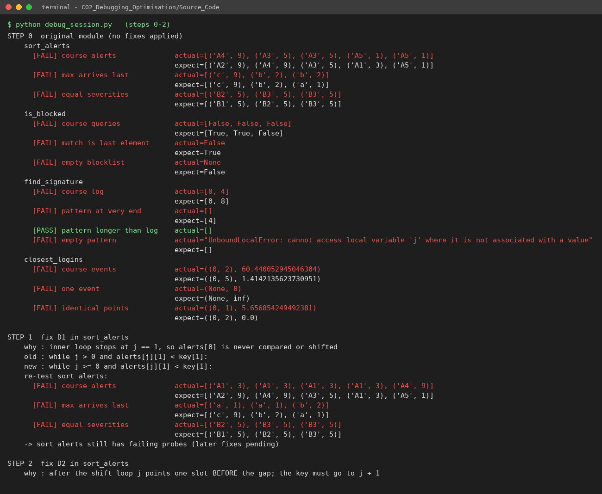{width=95%}

## b.2 `is_blocked` – D3 and D4

**Root cause.** A sequential search must (1) return `True` the moment an element matches, (2) keep scanning on a mismatch, and (3) return `False` only after the whole list was examined. The original does (1) wrong (`False`), and (2)+(3) wrong (`else: return False` ends the call at index 0; falling off an empty loop returns `None`).

| After fix | course queries `[10.0.0.9, 10.0.0.5, 8.8.8.8]` | empty list | last element | Result |
|---|---|---|---|---|
| none | `[False, False, False]` | `None` | `False` | FAIL |
| D3 | `[False, True, False]` – only the *first* IP (`10.0.0.5`) is found | `None` | `False` | FAIL (D4 pending) |
| D3 + D4 | `[True, True, False]` | `False` | `True` | **PASS** |

## b.3 `find_signature` – D5, D6 (and H1)

**Root cause.** For text length `n` and pattern length `m`, the valid start positions are `0 … n−m`, i.e. `n−m+1` windows – `range(n−m)` drops the last. After the inner loop, `j` holds the index where the loop *stopped*; `j == m−1` is true both for a full match (loop ran to the end) and for a mismatch **at the last character** (loop `break`s with `j = m−1`). The reliable test is "the loop never broke" (`for … else`).

**Alignment table** – `log = FAILFAIXFAIL` (n = 12), `pattern = FAIL` (m = 4):

| i | window | comparisons (log vs pattern) | original (`range(8)`, `j == m-1`) | corrected (`range(9)`, `for…else`) |
|---|---|---|---|---|
| 0 | `FAIL` | F=F A=A I=I L=L | HIT | HIT |
| 1 | `AILF` | A≠F | no hit | no hit |
| 2 | `ILFA` | I≠F | no hit | no hit |
| 3 | `LFAI` | L≠F | no hit | no hit |
| 4 | `FAIX` | F=F A=A I=I **X≠L** | **HIT – false positive (D6)** | no hit |
| 5 | `AIXF` | A≠F | no hit | no hit |
| 6 | `IXFA` | I≠F | no hit | no hit |
| 7 | `XFAI` | X≠F | no hit | no hit |
| 8 | `FAIL` | F=F A=A I=I L=L | **not scanned (D5)** | HIT |

| After fix | course log | pattern at very end (`xxxxFAIL`) | empty pattern | Result |
|---|---|---|---|---|
| none | `[0, 4]` | `[]` | `UnboundLocalError` | FAIL |
| D5 | `[0, 4, 8]` (end found, false hit remains) | `[4]` | `UnboundLocalError` | FAIL |
| D5 + D6 | `[0, 8]` | `[4]` | `[0, 1, 2, 3, 4]` (every index – wrong) | FAIL for empty pattern |
| D5 + D6 + H1 | `[0, 8]` | `[4]` | `[]` | **PASS** |

## b.4 `closest_logins` – D7, D8, D9

**Root cause.** A minimum search must start from `+∞`, replace the best value only when a candidate is **smaller**, and visit every unordered pair `{i, j}` exactly once. With `min_dist = 0` and `d > min_dist` the function actually computes the **maximum** distance (the pair `(0, 2)`, 60.44 km below, is the farthest pair in the data); with `j` over all indices it also compares each point with itself.

**Pair table for the course data** (15 pairs = 6·5/2):

| pair | d (km) | | pair | d (km) | | pair | d (km) |
|---|---|---|---|---|---|---|---|
| (0,1) | 28.79 | | (1,3) | 29.83 | | (2,5) | 59.03 |
| (0,2) | **60.44** (farthest – what the original returned) | | (1,4) | 20.00 | | (3,4) | 11.40 |
| (0,3) | 3.61 | | (1,5) | 27.51 | | (3,5) | 3.61 |
| (0,4) | 12.21 | | (2,3) | 60.22 | | (4,5) | 10.82 |
| **(0,5)** | **1.41 (closest)** | | (2,4) | 48.83 | | | |
| (1,2) | 34.41 | | | | | | |

| After fix | course events | one event | identical points `(5,5),(9,9),(5,5)` | Result |
|---|---|---|---|---|
| none | `((0,2), 60.44)` | `(None, 0)` | `((0,1), 5.66)` | FAIL |
| D7 | `(None, inf)` – `d > inf` is never true | `(None, inf)` | `(None, inf)` | FAIL |
| D7 + D8 | `((0,0), 0.0)` – the self pair wins | `((0,0), 0.0)` | `((0,0), 0.0)` | FAIL |
| D7 + D8 + D9 | `((0,5), 1.4142)` | `(None, inf)` | `((0,2), 0.0)` | **PASS** |

The three fixes are only meaningful together: D7 alone makes the function return nothing, D7 + D8 exposes D9 (the `(i,i)` pair has `d = 0`), and D9 completes the repair.

## b.5 Boundary tests (original vs corrected)

| Boundary case | Input | Expected | Original | Corrected |
|---|---|---|---|---|
| Empty blocklist | `[]`, `1.1.1.1` | `False` | `None` | `False` |
| Blocked IP is last element | `172.16.4.2` | `True` | `False` | `True` |
| Pattern at the very end | `xxxxFAIL`, `FAIL` | `[4]` | `[]` | `[4]` |
| Pattern equals the log | `FAIL`, `FAIL` | `[0]` | `[]` | `[0]` |
| Pattern longer than the log | `FAI`, `FAIL` | `[]` | `[]` | `[]` |
| Overlapping occurrences | `AAAAAA`, `AAAA` | `[0,1,2]` | `[0,1]` | `[0,1,2]` |
| Empty pattern | `FAIL`, `""` | `[]` | `UnboundLocalError` | `[]` |
| Equal severities | `B1..B4`, all 5 | `B1,B2,B3,B4` (arrival order) | `[B2,B3,B4,B4]` | `[B1,B2,B3,B4]` |
| Fewer than two events | `[]`, `[(1,1)]` | `(None, ∞)` | `(None, 0)` | `(None, inf)` |
| Identical locations | `(5,5),(9,9),(5,5)` | `((0,2), 0.0)` | `((0,1), 5.66)` | `((0,2), 0.0)` |
| Tie for closest pair | `(0,0),(1,0),(10,0),(11,0)` | `((0,1), 1.0)` | – | `((0,1), 1.0)` |

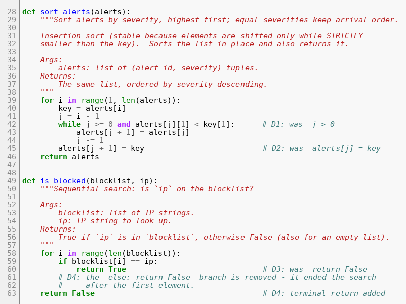{width=90%}

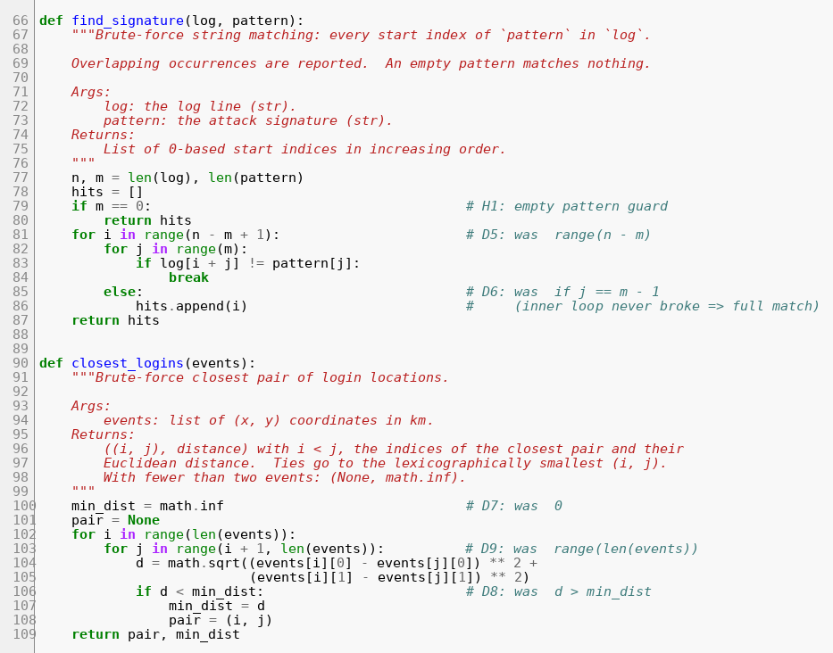{width=90%}

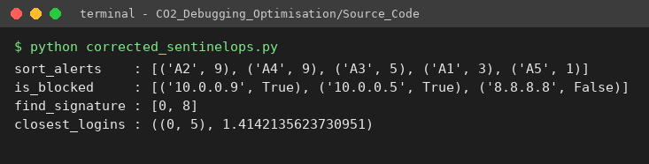{width=85%}

Test-suite result: the same 42 checks run on all three modules – **original 10 pass / 32 fail** (the failures are the defects), **corrected 42/42**, **optimised 42/42**, plus a 3,000-trial randomised differential test with 0 mismatches.

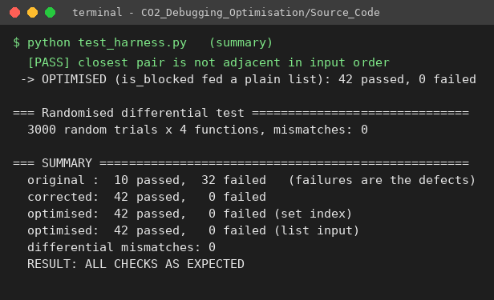{width=75%}

# Part (c) – Optimising the corrected module (10 marks)

Every optimisation was required to leave the output unchanged; this is enforced by `test_harness.py` (42 fixed checks per module and the randomised differential test against independent reference implementations). Pseudocode for each corrected/optimised pair is in `Pseudocode/`.

## c.1 `sort_alerts` – is insertion sort still suitable?

Insertion sort costs `(n − 1) + I` comparisons, where `I` is the number of inversions (pairs in the wrong order). For **nearly sorted** alert streams `I` is small, so it is linear, in place (O(1) extra space) and stable – a good fit. But the production module must survive any batch: an out-of-order burst of 50,000 alerts has `I ≈ 0.225·n² ≈ 5.6·10⁸` (severity 1–10) up to `n(n−1)/2 ≈ 1.25·10⁹` (reverse order). Measured: 1.49 s for 10,000 random alerts, so quadratic scaling projects to ≈ 37 s for 50,000 (extrapolation, not measured).

**Chosen approach:** Python's built-in Timsort through `alerts.sort(key=itemgetter(1), reverse=True)`. It is *adaptive* (detects already-ordered runs → ≈ n comparisons on nearly sorted data), has an `O(n log n)` worst case, and is *stable* – `reverse=True` keeps equal keys in arrival order. It still sorts in place and returns the list, so the interface and output are unchanged. Trade-off: `O(n)` temporary space.

## c.2 `is_blocked` – repeated lookups

A sequential search is `O(b)` per query, i.e. `O(q·b)` for `q` lookups. The blocklist changes rarely and is queried constantly, so it is indexed **once** in a hash set (`build_blocklist_index`, `O(b)`), after which `is_blocked(index, ip)` is an expected-`O(1)` membership test. The function still accepts a plain list, so it is a drop-in replacement. Trade-off: `O(b)` memory, and the index must be updated (`add`/`discard`) when the list changes.

## c.3 `find_signature` – no redundant comparisons

The corrected brute-force scan already abandons a window at its first mismatch. The optimised version additionally:

* returns immediately for an empty pattern or `m > n` (no scan at all);
* tries only the `n − m + 1` windows that can contain the pattern (no out-of-range indices);
* tests `log[i]` against the first pattern character once and drops the window at once if it differs, and starts the inner loop at `j = 1` so `pattern[0]` is never compared twice;
* removes the per-window `for…else` set-up of the inner `range` iterator (pure interpreter overhead).

An **optional extension**, `find_signature_horspool`, skips alignments with a bad-character table (average ≈ `n/m` comparisons). It is not needed for correctness and is clearly separated from the brute-force function.

## c.4 `closest_logins` – three optimisations

1. **No self or repeated pairs** (done in the correction): `n(n−1)/2` pairs instead of `n²`.
2. **No unnecessary square roots**: `√` is monotonic, so squared distances are compared and `math.sqrt` is called once at the end.
3. **Pruning**: events are sorted by x. For each point `a`, the scan to its right stops as soon as `(x_b − x_a)² > best`, because that point and every later one are already farther away in x than the best distance, so they cannot be closer. The test is strict (`>`) so pairs that *tie* with the best are still examined, which preserves the brute-force tie-break (smallest `(i, j)`); indices refer to the original event order.

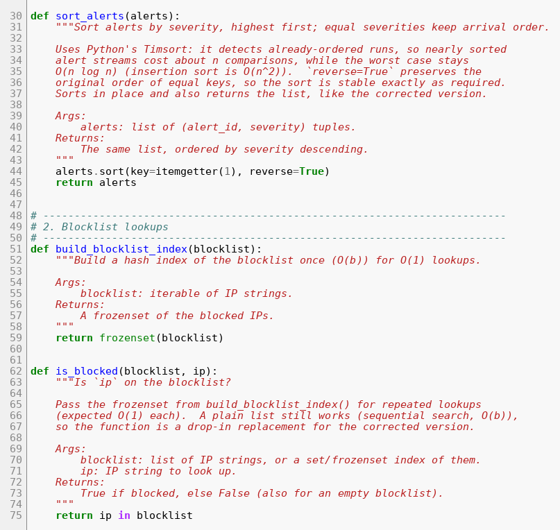{width=90%}

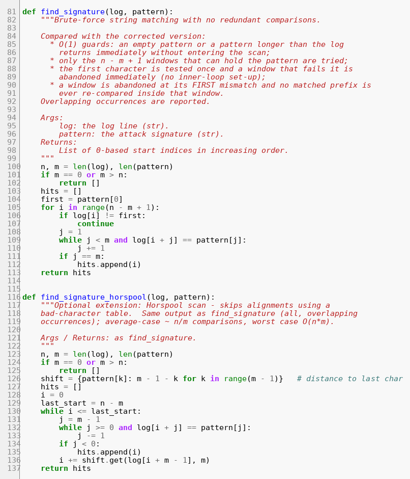{width=90%}

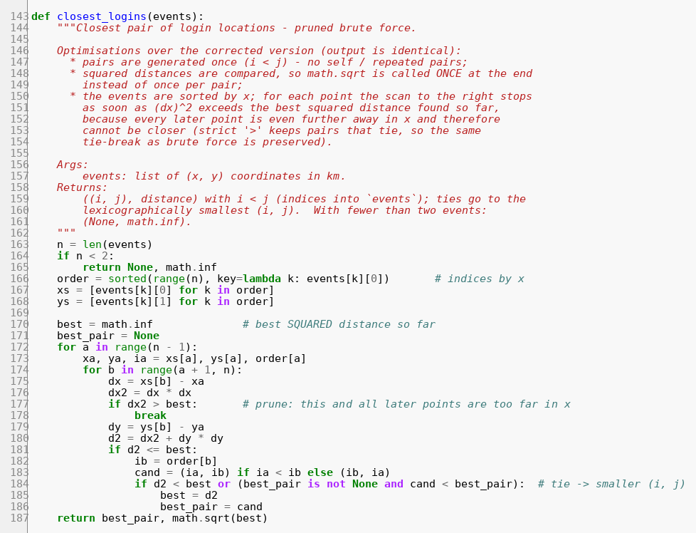{width=90%}

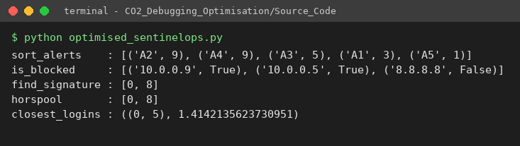{width=85%}

# Part (d) – Analysis before and after (10 marks)

*n* = alerts / log length / events, *b* = blocklist size, *q* = number of queries, *m* = pattern length, *I* = inversions.

## d.1 Operation counts and time complexity

| Function | Version | Basic operation | Count | Time | Space |
|---|---|---|---|---|---|
| `sort_alerts` | corrected insertion sort | key comparison | best `n−1`; general `(n−1)+I`; worst `n(n−1)/2` | `O(n)` best / `O(n²)` worst | `O(1)` |
| | optimised Timsort | key comparison | best ≈ `n−1`; worst ≤ `n⌈log₂ n⌉` | `O(n)` best / `O(n log n)` worst | `O(n)` |
| `is_blocked` | corrected sequential | string comparison | hit at position k: `k`; miss: `b`; `q` queries ≈ `q·b` worst | `O(b)` per query, `O(qb)` total | `O(1)` |
| | optimised hash set | hash probe | build `b` inserts + `q` probes | `O(b + q)` expected | `O(b)` |
| `find_signature` | corrected brute force | character comparison | per window = matched prefix + 1 (or `m`); best ≈ `n−m+1`, worst `(n−m+1)·m` | `O(nm)` worst | `O(1)` + hits |
| | optimised scan | character comparison | same count as corrected (already minimal for a left-to-right scan); no guard/loop-set-up overhead | `O(nm)` worst | `O(1)` + hits |
| | optional Horspool | character comparison | average ≈ `n/m`; worst `O(nm)` | | `O(σ)` |
| `closest_logins` | original (buggy) | distance + `√` | `n²` (incl. `n` self pairs) | `Θ(n²)` | `O(1)` |
| | corrected brute force | distance + `√` | exactly `n(n−1)/2` | `Θ(n²)` | `O(1)` |
| | optimised sweep | squared distance | sort `O(n log n)` + unpruned pairs; **1** `√`; worst `n(n−1)/2` (all same x) | `O(n log n)` + pairs; worst `Θ(n²)` | `O(n)` |

Derivations. *Insertion sort:* for element `i` the `while` loop makes one comparison per shift plus one failing comparison (none if it reaches the front), so total comparisons = shifts + `(n−1)` − r with shifts = `I`; `I = 0` for sorted input and `n(n−1)/2` for reversed. For random data with `k` equally likely severity levels, `E[I] = n²(1 − 1/k)/4` (a pair is an inversion iff the earlier alert has a *strictly* lower severity, probability `(1 − 1/k)/2`, over `n(n−1)/2` pairs). *Brute-force pairs:* the double loop `i < j` has `Σ_{i=0}^{n-2}(n−1−i) = n(n−1)/2` iterations; the original had `n·n`. *Signature scan:* the windows `i = 0…n−m` are `n−m+1`; a window costs between 1 and `m` comparisons.

## d.2 Measurements

### Sorting – insertion-sort comparisons, nearly sorted vs random (severity 1–10)

"Nearly sorted" = alerts sorted by severity with ≈ 1 % of the alerts swapped with another alert up to `n/20` positions away.

| n | input | insertion comparisons | inversions `I` (= shifts) | `(n−1)+I` | Timsort comparisons | predicted `I` for random: `0.225 n²` |
|---|---|---|---|---|---|---|
| 1,000 | random | 217,547 | 216,551 | 217,550 | 6,756 | 225,000 |
| 1,000 | nearly sorted | 1,339 | 340 | 1,339 | 2,329 | – |
| 2,000 | random | 888,391 | 886,394 | 888,393 | 13,831 | 900,000 |
| 2,000 | nearly sorted | 3,355 | 1,356 | 3,355 | 4,805 | – |
| 5,000 | random | 5,595,663 | 5,590,665 | 5,595,664 | 35,285 | 5,625,000 |
| 5,000 | nearly sorted | 13,261 | 8,262 | 13,261 | 10,112 | – |
| 10,000 | random | 22,403,533 | 22,393,537 | 22,403,536 | 70,945 | 22,500,000 |
| 10,000 | nearly sorted | 41,214 | 31,215 | 41,214 | 20,010 | – |

Running time at n = 10,000: insertion sort 1.494 s (random) vs 0.0028 s (nearly sorted); Timsort 0.0012 s (random) and 0.0002 s (nearly sorted).

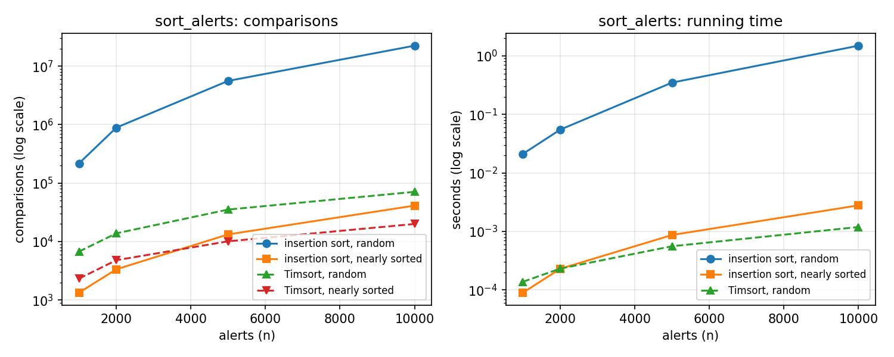{width=95%}

### Blocklist – sequential search vs hash set (2,000 queries, 50 % hits)

| Blocklist size `b` | Sequential comparisons | Hash set operations (build `b` + 2,000 probes) | Sequential time | Hash build + lookup time |
|---|---|---|---|---|
| 1,000 | 1,500,500 | 3,000 | 0.0371 s | 0.0002 s |
| 5,000 | 7,538,876 | 7,000 | 0.2124 s | 0.0010 s |
| 20,000 | 30,149,489 | 22,000 | 0.9916 s | 0.0028 s |

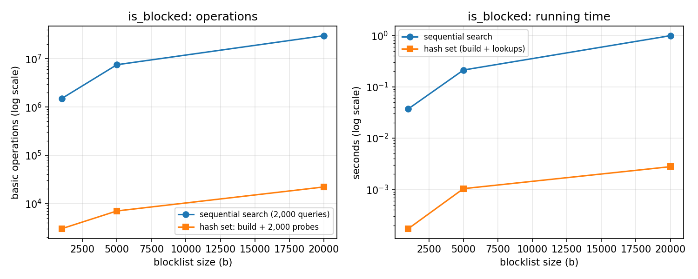{width=95%}

### Signature scan – character comparisons

| Case | n | m | Hits | Windows: original / correct | Brute force | Optimised | Horspool (optional) |
|---|---|---|---|---|---|---|---|
| random log | 10,000 | 4 | 4 | 9,996 / 9,997 | 10,270 | 10,270 | 2,681 |
| random log | 100,000 | 4 | 4 | 99,996 / 99,997 | 102,624 | 102,624 | 26,647 |
| random log | 200,000 | 4 | 4 | 199,996 / 199,997 | 205,160 | 205,160 | 53,298 |
| worst case `AAA…A` / `AAAAAAAB` | 20,000 | 8 | 0 | 19,992 / 19,993 | 159,944 | 159,944 | 19,993 |

Times (random log, n = 200,000): brute force 26.9 ms, optimised 7.3 ms, Horspool 8.3 ms.

### Closest pair – distance computations (events uniform in a 1000 km × 1000 km square, seed 2026)

| Batch size `n` | Original `n²` | Brute force `n(n−1)/2` | Optimised (pruned) | Reduction | `√` calls (brute → opt.) | Time brute | Time optimised |
|---|---|---|---|---|---|---|---|
| 1,000 | 1,000,000 | 499,500 | 1,694 | 295× | 499,500 → 1 | 0.101 s | 0.0006 s |
| 2,000 | 4,000,000 | 1,999,000 | 2,856 | 700× | 1,999,000 → 1 | 0.445 s | 0.0010 s |
| 4,000 | 16,000,000 | 7,998,000 | 7,552 | 1,059× | 7,998,000 → 1 | 1.548 s | 0.0023 s |
| 8,000 | 64,000,000 | 31,996,000 | 5,646 | 5,667× | 31,996,000 → 1 | 6.494 s | 0.0040 s |

For every size the optimised function returned the same pair and distance as brute force. Degenerate input (2,000 events all with the same x): brute force 1,999,000 and optimised 1,999,000 distance computations – no pruning is possible.

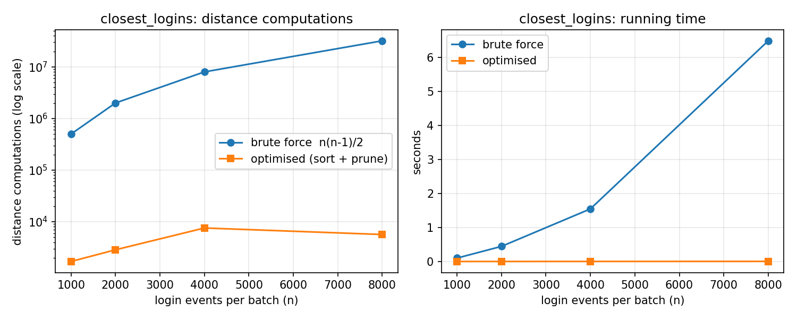{width=95%}

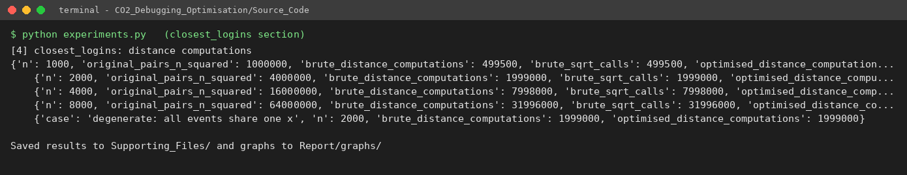{width=95%}

## d.3 Do the measurements agree with the analysis?

* **Insertion sort.** Comparisons equal `(n−1) + I` exactly for the nearly sorted inputs and differ from it by only a few units for random data (the few units are `r`, insertions that reach the front). The measured random inversions are within 4 % of the predicted `0.225 n²` (3.8 % at n = 1,000, 0.5 % at n = 10,000: 22.39 M vs 22.5 M), and the 10,000-alert random run is ≈ 25× the 2,000-alert one in comparisons (22.4 M / 0.89 M), as the `n²` law predicts (25×). Nearly sorted input is orders of magnitude cheaper (41 k vs 22.4 M comparisons) – insertion sort is adaptive, as analysed.
* **Timsort vs insertion sort on nearly sorted data – a nuance.** On the *least* disordered inputs (n = 1,000–2,000) insertion sort used **fewer** comparisons than Timsort (1,339 vs 2,329) because it pays only for the inversions, whereas Timsort pays for run detection and merging. As the disorder grows with `n` (here `I ≈ 3n`), Timsort overtakes it (20,010 vs 41,214 at n = 10,000). Timsort's real advantage is the guarantee: 70,945 comparisons on 10,000 random alerts versus 22.4 M, and it is also faster in wall-clock time for every case measured because its inner loops run in C. Timsort's random count is below `n log₂ n` (132,877) because severities take only 10 distinct values.
* **Blocklist.** Sequential comparisons match the model: with 50 % hits at a random position and 50 % misses, the expected cost is `q·(b/2·0.5 + b·0.5) = 0.75·q·b`, i.e. 1.5 M for b = 1,000 (measured 1,500,500) and 30.1 M for b = 20,000 (measured 30,149,489); it grows linearly with `b`, whereas the hash set needs `b + q` operations. Wall-clock time follows (0.99 s vs 2.8 ms at b = 20,000, ≈ 350×).
* **Signature scan.** On random text over a 40-character alphabet, almost every window fails on its first comparison, so the count is ≈ `1.026·n` (10,270 for n = 10,000 – 2.7 % more than the 9,997 windows), as the model predicts; the adversarial case reaches exactly `(n−m+1)·m = 19,993 × 8 = 159,944`. **The optimised scan performs exactly the same number of character comparisons as the corrected one** – the corrected scan was already minimal for a left-to-right search – so its measured gain (≈ 3.7× faster, 7.3 ms vs 26.9 ms) comes from lower interpreter overhead, not fewer comparisons, and in the adversarial case it is not faster (9.5 ms vs 8.8 ms). Only the optional Horspool variant reduces the comparison count (≈ n/m on random text: 26,647 vs 102,624), and its worst case remains `O(nm)` in theory.
* **Closest pair.** The brute-force counts equal `n(n−1)/2` exactly (499,500 … 31,996,000), a 4× increase per doubling of `n`, as `Θ(n²)` predicts, and the original would have needed `n²` (twice as many). The pruned sweep needed 0.3 %–0.02 % as many distance computations and one square root instead of tens of millions; its time grew from 0.6 ms to 4 ms. For uniformly spread events the best distance found so far quickly becomes small (of the order of the spacing between neighbouring events), so only a handful of points lie within `|dx| ≤ √best` and the scan after the sort is close to linear; this is an empirical/heuristic observation (the counts are not strictly monotonic, e.g. 7,552 at n = 4,000 vs 5,646 at n = 8,000, because the number of pruned pairs depends on how early a close pair is met in the sweep), not a worst-case bound. The degenerate vertical-line test confirms the analysis that the worst case stays `Θ(n²)`; the sort-by-x pruning is an effective heuristic on spread-out locations, and a divide-and-conquer closest-pair algorithm would be needed for a guaranteed `O(n log n)`.

Production implication (50,000 alerts and 8,000 login events per day): sorting drops from a worst case of ≈ 1.25·10⁹ comparisons to < 10⁶, each blocklist lookup becomes constant time, and the login-clustering report drops from ≈ 32 million distance evaluations (≈ 6.5 s here) to a few thousand (≈ 4 ms) for realistic data.

# Part (e) – Production-quality code (8 marks)

* **`Source_Code/optimised_sentinelops.py`** – final module: module and function docstrings (arguments, returns, tie-break rules, complexity), comments tagged with the optimisation applied, no global state.
* **`Source_Code/corrected_sentinelops.py`** – the minimally patched original; every changed line carries a `D1…D9` / `H1` comment saying what it was before.
* **`Source_Code/test_harness.py`** – 42 checks per module (every function, the course data and all boundary cases of part (b)), run against the original (to prove the tests detect the defects), the corrected and the optimised module, plus a 3,000-trial randomised differential test against independent references (`sorted` with a negated key, regular-expression look-ahead, `itertools.combinations` + `math.dist`, and `in`). It exits with a non-zero status if anything unexpected happens.
* **`Source_Code/debug_session.py`, `trace_demo.py`, `experiments.py`** – reproduce every table in this report.

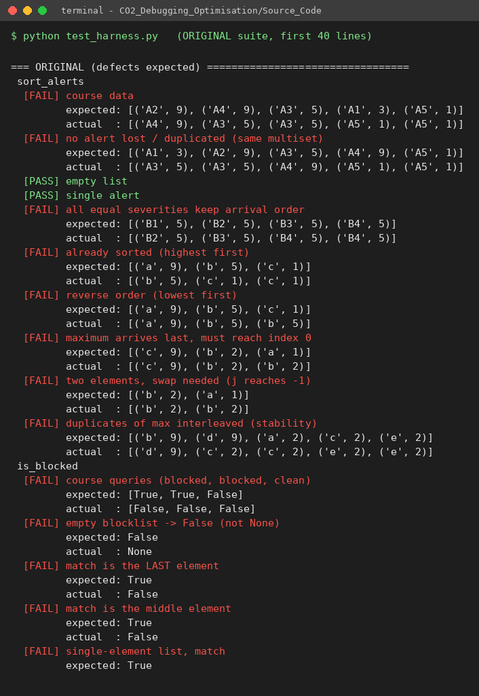{width=90%}

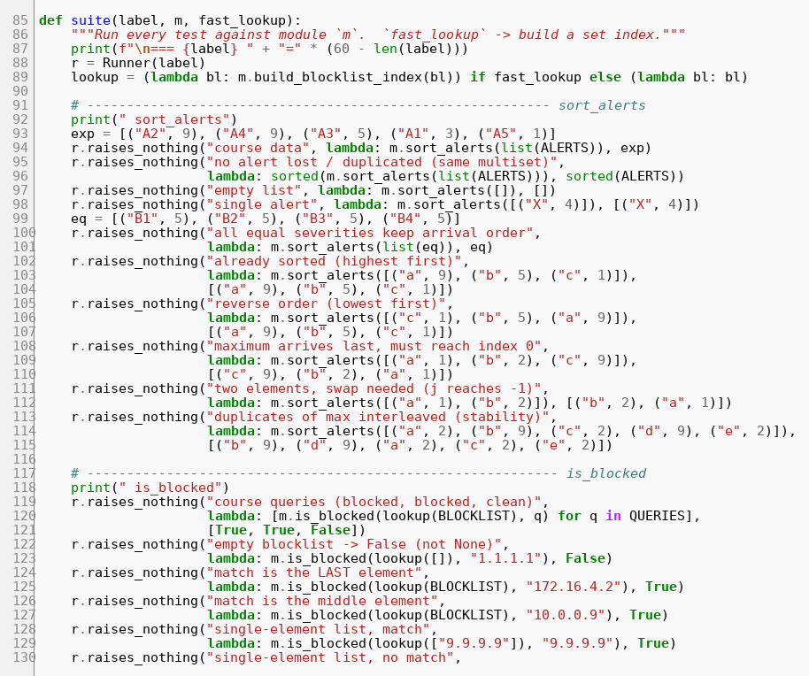{width=90%}

Reproduce everything:

```
cd Source_Code
python original_sentinelops.py      # the failing behaviour
python debug_session.py             # one fix at a time, re-tested
python test_harness.py              # 42 checks x 3 modules + 3,000 random trials
python experiments.py               # part (d) measurements, graphs and CSV/JSON
```

# Limitations and assumptions

* Severity is numeric and higher = more severe; events are numeric `(x, y)` pairs. Distances are Euclidean on the given km coordinates (no geodesic correction).
* Two distinct squared distances that round to the same `float` `sqrt` could in principle be ordered differently by the brute-force and the squared-distance comparison; this does not occur for the integer and 2-decimal coordinates tested (3,000 randomised comparisons, 0 mismatches).
* Timings were taken on one machine and vary run to run; operation counts are deterministic. The 50,000-alert figures in c.1 and d.3 are extrapolations from the measured 10,000-alert runs, not separate measurements.
* The screenshots in `Report/screenshots/` were rendered from the real source files and the real program output by `Supporting_Files/make_screenshots.py`; replace them with captures from your own editor/terminal if your instructor requires literal screen grabs.

# Code of conduct

I ______________________________ (Name / Reg. No.) certify that this submission is my original work and that I have adhered to the guidelines specified for this assessment.

Signature: ____________________  Date: ______________
